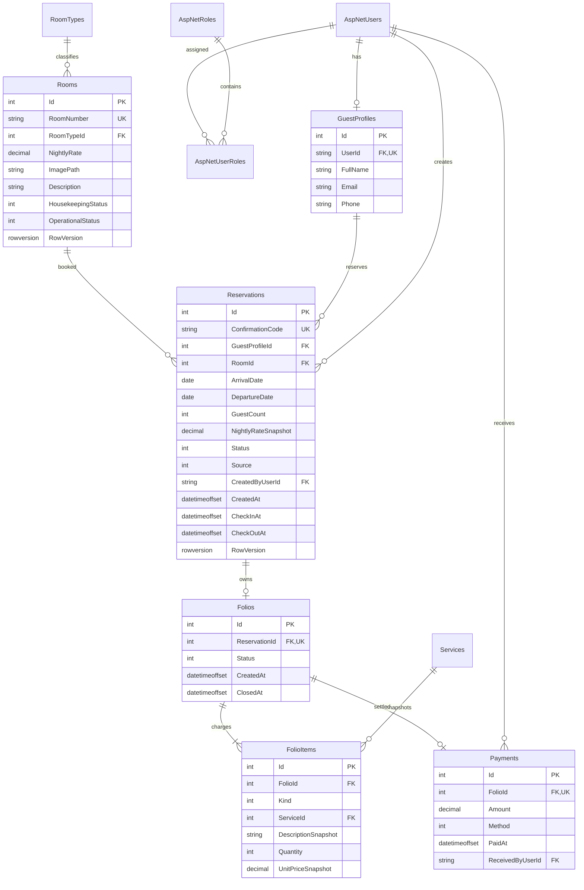
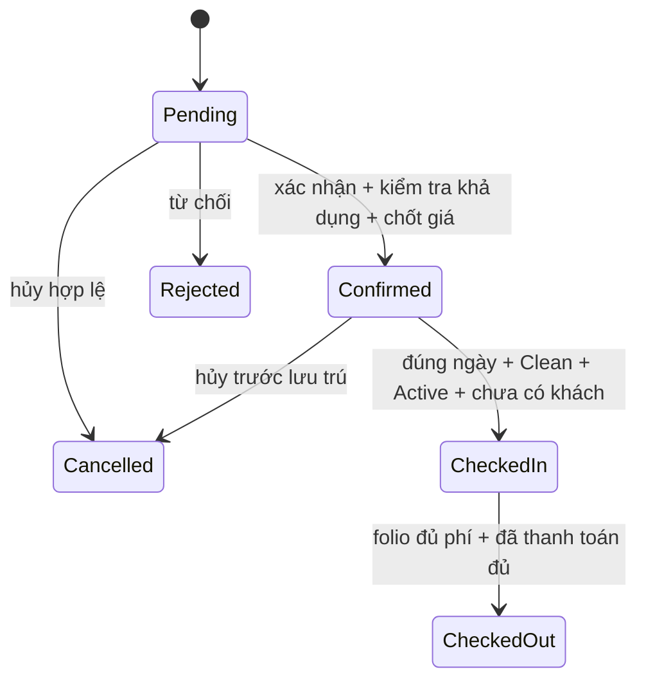
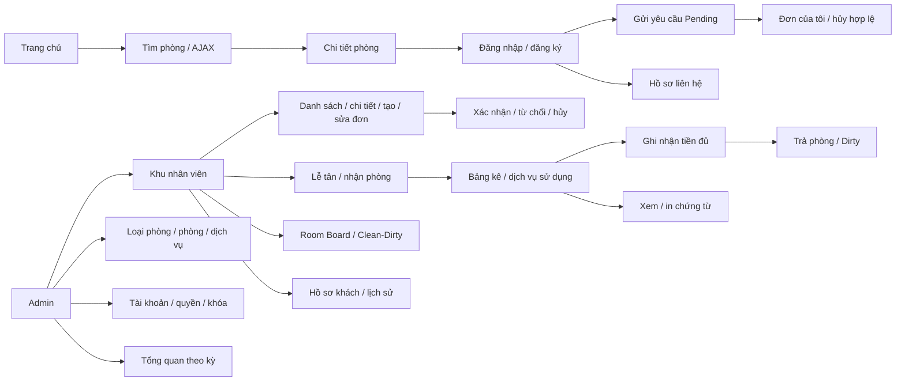

# Thiết kế kỹ thuật Aurora Hotel

## Kiến trúc và trách nhiệm

`Controllers` phục vụ khách; `Areas/Staff/Controllers` phục vụ nhân viên. `ViewModels` xác thực dữ liệu nhập và ngăn overposting. `HotelOperations` giữ quy tắc kỳ ở, khả dụng, trạng thái đơn, nhận phòng, phí và thu tiền. `CatalogService` dùng chung giữa MVC và REST API cho dịch vụ; quản lý phòng, loại phòng, lọc HTML và upload. `HotelDbContext` là schema duy nhất, kế thừa IdentityDbContext. `SeedData` chỉ chạy trong Development. `Views/Shared` chứa thành phần dùng chung; CSS và JS nằm trong `wwwroot`.

Controller kiểm tra quyền qua `[Authorize]`, xác thực ModelState, đọc UserId từ claim rồi gọi service. Giá, chủ hồ sơ, tổng phải thu và trạng thái không lấy từ trường do trình duyệt tự quyết định. Server trả 400 cho validation/CSRF, 401/403 ở API và 404 khi khách truy cập đơn không thuộc mình; MVC dùng trang lỗi/redirect login theo Identity.

## ERD

UserId trên GuestProfile được null cho khách trực tiếp, unique có filter khi khác null. Không hợp nhất hồ sơ dựa theo email. Tiền là decimal(18,0). Ngày nghiệp vụ là SQL `date`; thời điểm là `datetimeoffset`. Ràng buộc check bảo vệ khoảng ngày, số khách/số lượng, giá trị tiền; khóa ngoại `Restrict` bảo toàn lịch sử. Có unique filtered index chỉ cho một Reservation CheckedIn mỗi RoomId và một dòng Kind=Room mỗi FolioId. Folio.ReservationId và Payment.FolioId unique.

## Trạng thái

Folio: Open → Paid → Closed. Open chỉ được chỉnh khi Reservation đang CheckedIn. Không sửa phí sau Paid. Một lần thanh toán đủ; gửi lại cùng số tiền/phương thức trả thành công mà không tạo bản ghi mới. Khác số tiền/phương thức sau khi đã thu bị từ chối. Check-in và checkout lặp lại không mở folio/thu phí/đổi housekeeping lần nữa.

Occupancy suy ra từ Reservation.Status=CheckedIn. Clean/Dirty không trộn vào occupancy. Active/OutOfOrder là khai thác; chuyển OutOfOrder bị chặn nếu còn Confirmed hoặc CheckedIn, kể cả Confirmed quá ngày chưa xử lý. Dirty không loại khỏi tìm kiếm tương lai.

## Chống thao tác đồng thời

Tất cả lệnh ghi nghiệp vụ qua `HotelOperations.Atomic`: bắt đầu transaction, lấy `sp_getapplock` Exclusive với LockOwner=Transaction và tài nguyên `AuroraHotel:operations`, đọc lại dữ liệu, kiểm tra, SaveChanges, Commit. Lỗi tự rollback. Transaction-scoped lock của SQL Server áp dụng giữa các process/server cùng database; không dựa vào semaphore trong bộ nhớ. Unique indexes là lớp bảo vệ bổ sung.

Đây là khóa chung cho một khách sạn, dễ đọc và dễ chứng minh tính đúng trong đồ án; đổi lại các ghi nghiệp vụ được tuần tự hóa. Nếu mở rộng tải cao, thay bằng khóa theo phòng/folio với thứ tự lấy khóa thống nhất và kiểm thử deadlock. Không thêm retry mù khi request có tác dụng phụ. Giá chốt chỉ đổi khi nhân viên chủ động thay phòng/lịch trước nhận phòng, và UI báo rõ chính sách.

## Sơ đồ trang

## Bảng quyền

| Nhóm chức năng | Chưa đăng nhập | Customer | Receptionist | Admin |
|---|---|---|---|---|
| Trang chủ/tìm/chi tiết | Có | Có | Có | Có |
| Đăng ký công khai | Chỉ Customer | Chỉ Customer | Chỉ Customer | Chỉ Customer |
| Đơn/hồ sơ cá nhân | Không | Chỉ của mình | Luồng nhân viên | Luồng nhân viên |
| Danh sách khách/đơn, điều hành lưu trú | Không | Không | Có | Có |
| Clean/Dirty | Không | Không | Có | Có |
| Folio/dịch vụ sử dụng/thu tiền/in | Không | Không | Có | Có |
| Catalog CRUD/OutOfOrder | Không | Không | Không | Có |
| Phân quyền/khóa/dashboard tổng hợp | Không | Không | Không | Có |

Không chỉ ẩn nút: server chặn từng controller/action. Customer truy vấn ID đơn luôn kèm điều kiện GuestProfile.UserId=claim UserId. Profile bỏ qua Id khách do client gửi. Admin không tự đổi quyền/khóa phiên đang dùng, không làm mất Admin hoạt động cuối cùng. Thay quyền/khóa cập nhật security stamp; cookie cũ mất hiệu lực khi request tiếp theo.

## Trang/API và HTTP

| Route | Method | Quyền / công dụng |
|---|---|---|
| `/`, `/Rooms`, `/Rooms/Details/{id}` | GET | Công khai, trang phòng |
| `/Account/Login`, `/Account/Register` | GET/POST | Identity, public role Customer |
| `/Account/Logout` | POST | Đã đăng nhập |
| `/Account/Profile` | GET/POST | Customer, hồ sơ của mình |
| `/Bookings/Select` | POST | Session giữ lựa chọn trước đăng nhập |
| `/Bookings/Create` | GET/POST | Customer, tạo Pending |
| `/Bookings`, `/Bookings/Details/{id}` | GET | Customer, chỉ đơn của mình |
| `/Bookings/Cancel/{id}` | POST | Customer, điều kiện hủy |
| `/Staff/Reservations/{action}/{id?}` | GET hoặc POST đúng hành động | Staff, CRUD nghiệp vụ đặt phòng |
| `/Staff/FrontDesk` | GET | Staff, tabs nhận/đang ở/trả |
| `/Staff/FrontDesk/CheckIn/{id}` | POST | Staff, nhận phòng |
| `/Staff/FrontDesk/Folio/{id}`, `Invoice/{id}` | GET | Staff, đọc/in; không tạo phí khi đọc |
| `/Staff/FrontDesk/Charge`, `UpdateCharge`, `DeleteCharge`, `Pay`, `CheckOut` | POST | Staff, id là folio ID |
| `/Staff/Board`, `/Staff/Guests` | GET | Staff |
| `/Staff/Board/Housekeeping/{id}` | POST | Staff |
| `/Staff/Board/Operation/{id}` | POST | Admin |
| `/Staff/Catalog/*`, `/Staff/Users/*`, `/Staff/Dashboard` | Theo action | Admin |
| `/api/rooms/availability` | GET | Public, SearchInput; JSON total/page/pageSize/pages/items |
| `/api/services`, `/api/services/{id}` | GET | Staff |
| `/api/services` | POST | Admin, ServiceInput; 201 + Location |
| `/api/services/{id}` | PUT | Admin, ServiceInput; 204 |
| `/api/services/{id}` | DELETE | Admin; xóa chưa dùng/ngừng nếu có lịch sử; 204 |

AJAX tìm kiếm gọi API khả dụng và cập nhật kết quả, URL và phân trang. Form GET vẫn chạy khi tắt JavaScript. Link quay lại từ chi tiết giữ bộ lọc; return URL được kiểm tra nội bộ. Body JSON ghi dữ liệu dùng header `X-CSRF-TOKEN` chứa token lấy từ hidden input trên trang đã xác thực, đồng thời gửi cookie. MVC form tạo token bằng Tag Helpers.

## Bảo mật, nhập liệu và quốc tế hóa

Identity cookie HttpOnly/SameSite Lax, lockout 5 lần đăng nhập thất bại trong 10 phút, mật khẩu >=8 với đủ thành phần, URL quay lại nội bộ. Toàn bộ POST/PUT/DELETE cookie được AutoValidateAntiforgeryToken. DataAnnotations/ViewModels hạn chế trường sửa; ORM truy vấn tham số. HTML mô tả chỉ cho p/br/b/strong/em/i/ul/ol/li/h3/h4, không cho thuộc tính/style/script/img. Nội dung còn lại Razor encode.

Upload JPEG/PNG/WebP tối đa 5 MB; kiểm tra extension và định dạng giải mã; giới hạn 8.000 px mỗi chiều/32 MP trước giải mã, tên UUID, ghi lại WebP vào static uploads. Không dùng tên file client, không giữ metadata hoặc file thực thi. CSP chỉ cho tài nguyên/script cùng nguồn; header nosniff/frame DENY. Không trả lỗi stack trace ra trình duyệt.

Nhãn nghiệp vụ ở Ui.Label; định dạng Ui.Date/Money/Time, văn hóa vi-VN, HotelClock dùng múi giờ cấu hình (mặc định Việt Nam). Để mở rộng ngôn ngữ: chuyển nhãn Views/DataAnnotations/Ui.Label sang Resources `.resx` + `IViewLocalizer`/`IStringLocalizer`, thêm supported cultures và kiểm thử từng ngôn ngữ. Hiện không có nút đổi ngôn ngữ.
